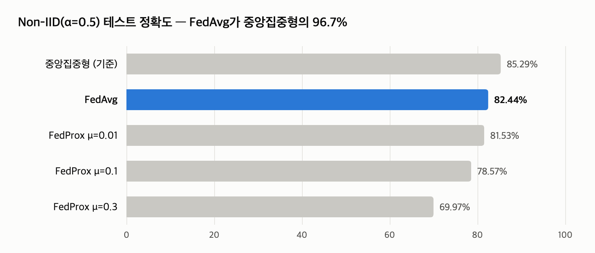
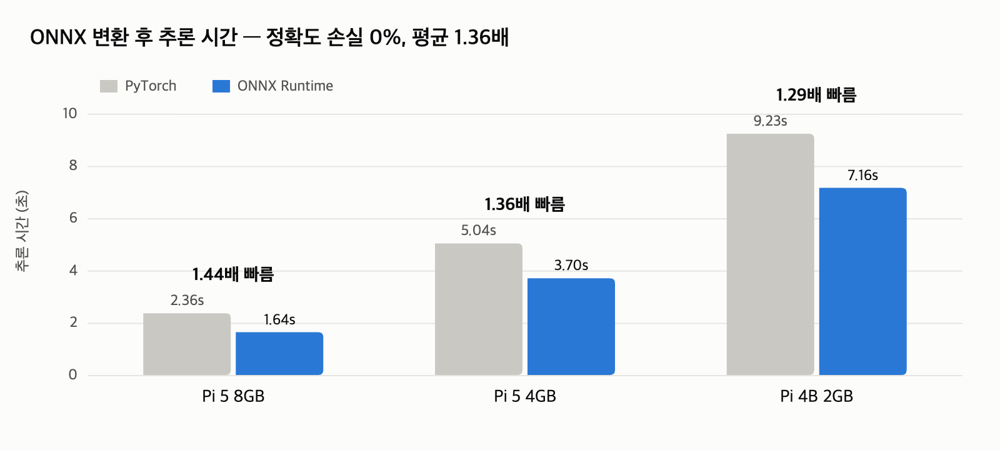
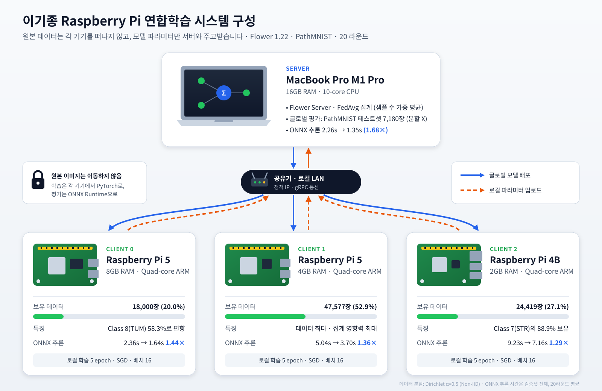
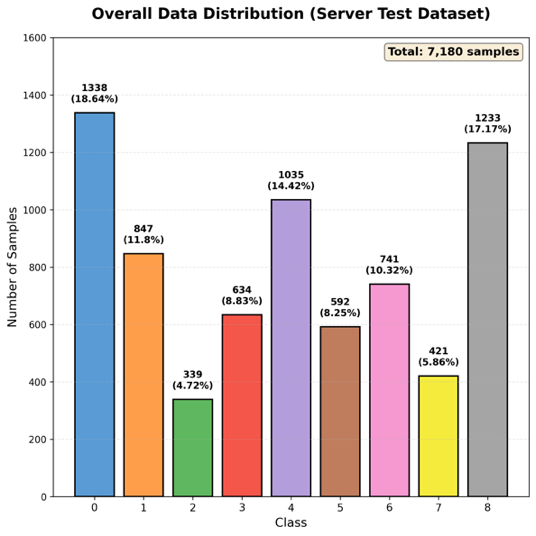
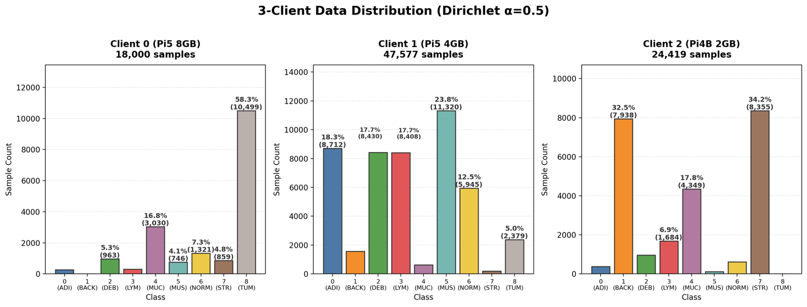
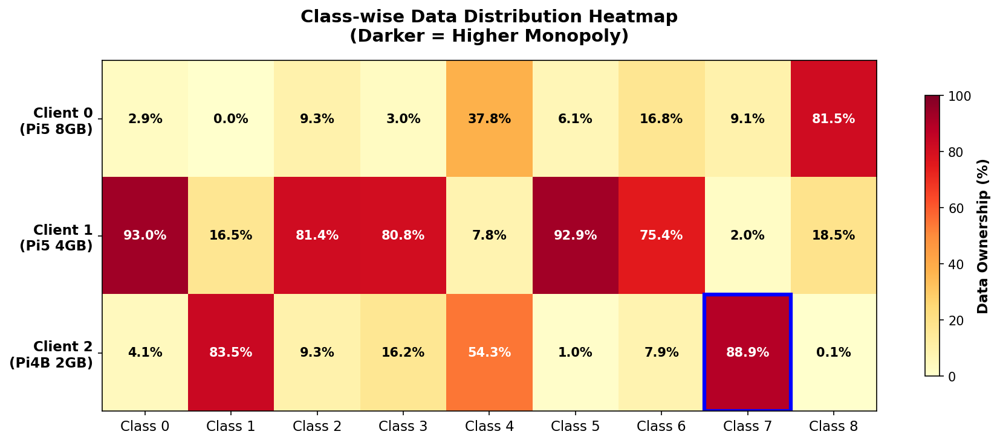
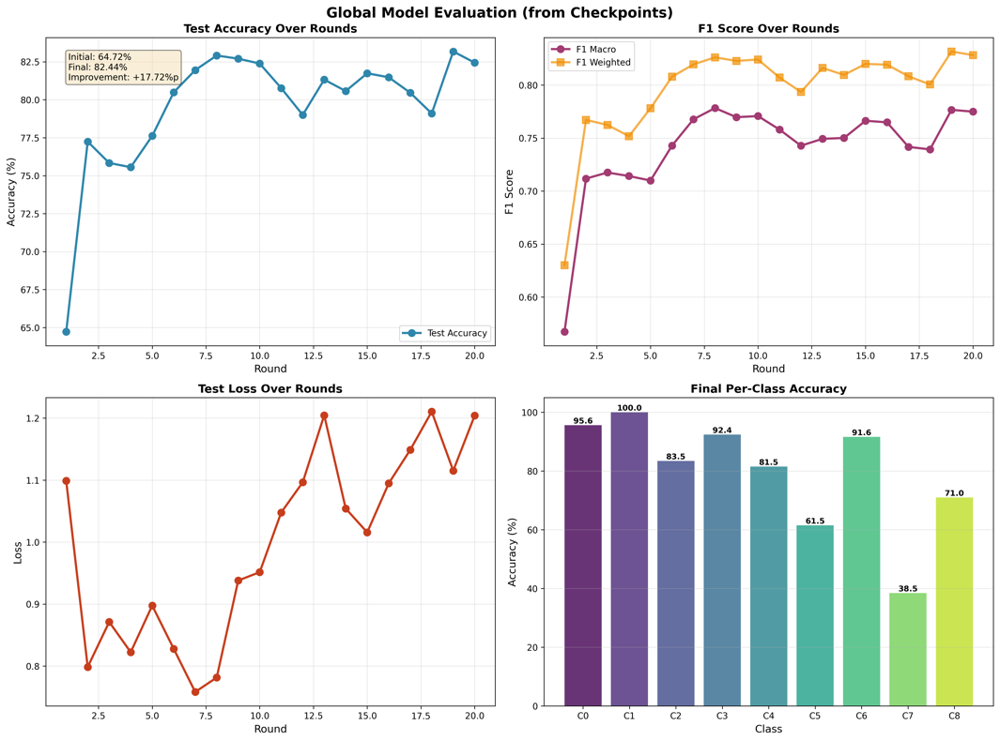
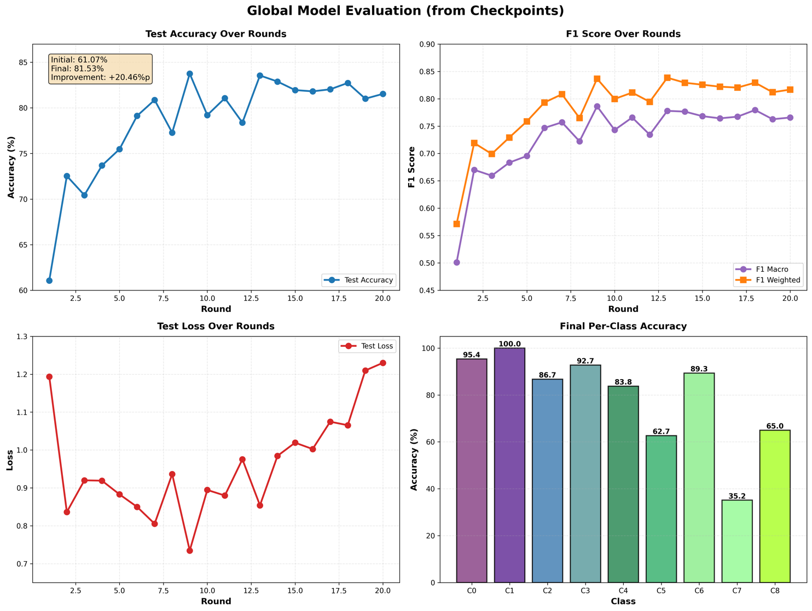
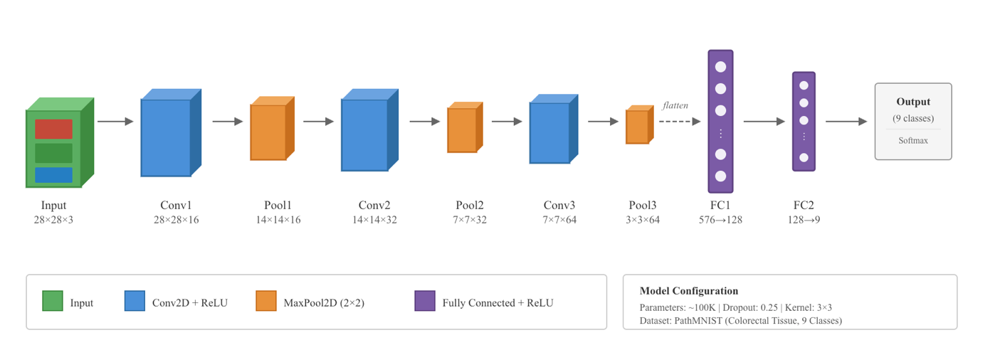
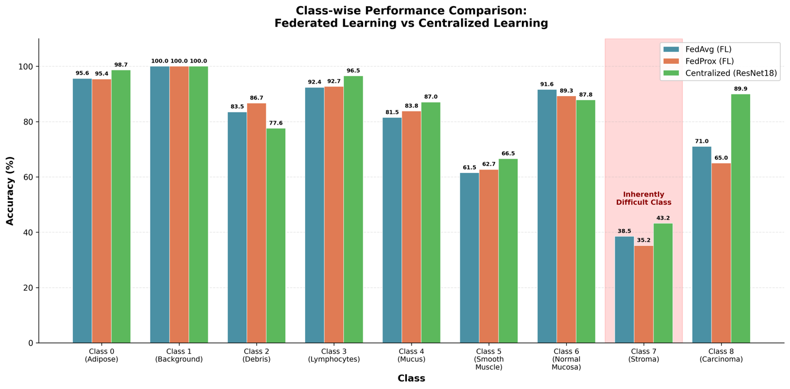

# 이기종 Raspberry Pi에서 돌아가는 연합학습 의료 영상 분류

> 학부 졸업논문 · 단독 연구 (2025.09 – 2025.12) · [논문 PDF (국문)](./paper/Lee_Kumin_Thesis_2026.pdf)
> Federated Learning-based Medical Image Classification System in Heterogeneous Edge Device Environment

연합학습 선행 연구 대부분은 시뮬레이션에서 검증됩니다. 이 프로젝트는 사양이 다른 Raspberry Pi 3대를 각각 다른 병원의 컴퓨터로 두고, 실제 기기에서도 같은 성능이 나오는지와 어떤 제약이 생기는지를 확인했습니다.

## 한눈에 보기

| | |
| --- | --- |
| 문제 | 검증된 ResNet18로 시작했지만 가장 저사양인 Pi 4B(2GB)에서는 한 라운드에 1시간이 넘게 걸리고 발열로 꺼짐 |
| 한 일 | 약 100K 파라미터 경량 CNN 설계 · Flower로 Pi 3대 클러스터 구성 · Non-IID(α=0.5)에서 FedAvg·FedProx 비교 · ONNX 추론 최적화 · 특정 클래스 성능 저하를 대조 실험으로 원인 분석 |
| 결과 | 정확도 82.44%, 중앙집중형(85.29%)의 96.7% · ONNX로 추론 평균 1.36배 빠름, 정확도 손실 0% |
| 발견 | 더 나을 것으로 예상한 FedProx가 이 환경에서는 μ가 클수록 오히려 낮아짐 |
| 남은 과제 | 통신이 불안정한 기기 하나가 라운드 전체를 붙잡고, 모두가 가장 느린 기기를 기다리는 구조 |





## 연구 목적

1. 이질적 Raspberry Pi 클러스터로 실제 의료 기관의 다양한 하드웨어 환경 재현
2. 극단적 Non-IID 환경(Dirichlet α=0.5)에서 FedAvg와 FedProx 성능 비교
3. ONNX 최적화를 통한 추론 속도, 메모리 효율성 개선 효과 검증
4. 개인정보 보호와 엣지 제약을 만족하는 연합학습 시스템의 실용성 평가

## 프로젝트 구조

```
.
├── README.md                    # 프로젝트 문서
│
├── paper/                       # 논문
│   └── Lee_Kumin_Thesis_2026.pdf  # 졸업논문 (Korean)
│
├── fedavg/                      # FedAvg 알고리즘
│   ├── server.py               # FedAvg 서버 (글로벌 평가 기능 포함)
│   ├── client.py               # FedAvg 클라이언트 (Non-IID 지원)
│   ├── run_server.sh           # 서버 실행 스크립트
│   └── run_clients.sh          # 클라이언트 실행 가이드
│
├── fedprox/                     # FedProx 알고리즘
│   ├── server.py               # FedProx 서버 (Proximal term 적용)
│   ├── client.py               # FedProx 클라이언트 (μ 파라미터 조절)
│   ├── run_server.sh           # 서버 실행 스크립트
│   └── run_clients.sh          # 클라이언트 실행 가이드
│
├── fedavg_onnx/                 # FedAvg + ONNX 최적화
│   ├── server.py               # PyTorch vs ONNX 비교 서버
│   ├── client.py               # PyTorch vs ONNX 비교 클라이언트
│   ├── run_experiment.sh       # 실험 실행 스크립트
│   └── run_clients.sh          # 클라이언트 실행 가이드
│
└── utils/                       # 유틸리티 스크립트
    ├── create_noniid_data.py   # Dirichlet 기반 Non-IID 데이터 생성
    └── preprocess_iid_data.py  # IID 데이터 전처리
```

## 실험 환경



### 하드웨어

| 역할 | 기기 | 사양 |
|------|------|------|
| Client 0 | Raspberry Pi 5 | 8GB RAM, Quad-core ARM CPU |
| Client 1 | Raspberry Pi 5 | 4GB RAM, Quad-core ARM CPU |
| Client 2 | Raspberry Pi 4B | 2GB RAM, Quad-core ARM CPU |
| Server | MacBook Pro M1 Pro | 16GB RAM, 10-core CPU |

### 소프트웨어

- **Python**: 3.9
- **딥러닝**: PyTorch 2.7
- **연합학습**: Flower 1.22
- **데이터셋**: MedMNIST 3.0.2 (PathMNIST)
- **최적화**: ONNX 1.19.1, ONNX Runtime 1.23.2
- **평가**: scikit-learn

### 데이터셋: PathMNIST

- **데이터 구성**:
  - 훈련 데이터: 89,996개
  - 검증 데이터: 10,004개
  - 테스트 데이터: 7,180개
- **이미지 크기**: 28×28 픽셀 (RGB)
- **클래스 수**: 9개 (대장 조직 병리 분류)
  - Adipose(지방), Background(배경), Debris(세포 파편), Lymphocytes(림프구), Mucus(점액), Smooth Muscle(평활근), Normal Colon Mucosa(정상 점막), Cancer-associated Stroma(암 관련 기질), Colorectal Adenocarcinoma Epithelium(대장 선암 상피)

훈련 데이터(NCT, 환자 86명)와 테스트 데이터(CRC-VAL-HE-7K, 환자 50명)는 서로 다른 기관에서 수집돼 클래스 비율이 다릅니다. 아래는 서버가 글로벌 평가에 쓰는 테스트셋 분포입니다.



### Non-IID 데이터 분할 (Dirichlet α=0.5)

| Client | 총 데이터 | 비율 | 특징 |
|--------|-----------|------|------|
| Client 0 | 18,000개 | 20.0% | Class 8 (58.3%) 편향 |
| Client 1 | 47,577개 | 52.9% | 가장 많은 데이터, 가장 큰 영향력 |
| Client 2 | 24,419개 | 27.1% | Class 7 (88.9%) 독점 |



같은 데이터를 "각 클래스를 어느 클라이언트가 얼마나 갖고 있나"로 바꿔 보면 독점 구조가 더 잘 보입니다. Class 7(STR)은 88.9%가 Client 2(Pi 4B)에 몰려 있습니다.



**평가 방식.** 처음에는 테스트 데이터도 클라이언트별로 나눴는데, 그러면 클라이언트마다 평가 기준이 달라져 지표가 왜곡됐습니다. 그래서 (1) 훈련 데이터만 Dirichlet로 나누고, (2) 각 클라이언트 훈련 데이터의 20%를 로컬 검증용으로 떼고, (3) 테스트셋은 나누지 않고 서버에서 글로벌 평가에만 쓰도록 바꿨습니다.

## 설치 및 실행

### 필수 패키지 설치

```bash
pip install torch torchvision
pip install flwr
pip install medmnist
pip install scikit-learn pandas numpy
pip install onnx onnxruntime onnxsim  # ONNX 실험용
```

### 1. FedAvg 실행

**서버 시작:**
```bash
cd fedavg
python server.py --num_rounds 20 --num_clients 3 --alpha 0.5 --port 8080
```

**클라이언트 시작 (각각 다른 터미널):**
```bash
# 터미널 1 (Client 0)
python client.py --client_id 0 --total_clients 3 --alpha 0.5 --server_address 192.168.x.x:8080

# 터미널 2 (Client 1)
python client.py --client_id 1 --total_clients 3 --alpha 0.5 --server_address 192.168.x.x:8080

# 터미널 3 (Client 2)
python client.py --client_id 2 --total_clients 3 --alpha 0.5 --server_address 192.168.x.x:8080
```

### 2. FedProx 실행

**서버 시작:**
```bash
cd fedprox
python server.py --num_rounds 20 --num_clients 3 --alpha 0.5 --mu 0.01 --port 8080
```

**클라이언트 시작:**
```bash
# μ=0.01 (권장값)
python client.py --client_id 0 --total_clients 3 --alpha 0.5 --mu 0.01 --server_address 192.168.x.x:8080
```

### 3. FedAvg + ONNX 비교 실험

**데이터 전처리 (최초 1회):**
```bash
cd utils
python preprocess_iid_data.py --num_clients 3
```

**서버 시작:**
```bash
cd fedavg_onnx
python server.py --num_rounds 20 --min_clients 3 --experiment_name onnx_comparison
```

**클라이언트 시작:**
```bash
python client.py --client_id 0 --server_address 192.168.x.x:8080
```

## 주요 파라미터

### 공통 파라미터

- `--num_rounds`: 연합학습 라운드 수 (기본값: 20)
- `--num_clients`: 전체 클라이언트 수 (기본값: 3)
- `--alpha`: Dirichlet 분포의 alpha 값 (Non-IID 강도 조절)
  - `0.1`: 극단적 Non-IID
  - `0.5`: 중간 Non-IID (본 연구 사용)
  - `10.0`: IID에 가까움
- `--local_epochs`: 클라이언트 로컬 학습 에포크 (기본값: 5)
- `--lr`: 학습률 (기본값: 0.001)
- `--batch_size`: 배치 크기 (기본값: 16~32)

### FedProx 전용 파라미터

- `--mu`: Proximal term 계수 (기본값: 0.01)
  - `0.0`: FedAvg와 동일
  - `0.01`: 약한 regularization (권장)
  - `0.1`: 중간 regularization
  - `1.0`: 강한 regularization

## 실험 결과

### 알고리즘 성능 비교

| 알고리즘 | Accuracy | F1 (Macro) | F1 (Weighted) | Class 7 Acc |
|----------|----------|------------|---------------|-------------|
| **중앙집중형 (SimpleCNN)** | 85.29% | 0.8014 | 0.8588 | 39.27% |
| **FedAvg (LR=0.001)** | **82.44%** | **0.7749** | **0.8282** | 38.5% |
| FedAvg (LR=0.002) | 81.52% | 0.7612 | 0.8184 | 31.1% |
| FedProx (μ=0.01) | 81.53% | 0.7657 | 0.8167 | 35.2% |
| FedProx (μ=0.1) | 78.57% | 0.7240 | 0.7927 | 37.3% |
| FedProx (μ=0.3) | 69.97% | 0.6318 | 0.6840 | 9.0% |

### 라운드별 학습 곡선

FedAvg(LR=0.001)는 1라운드 64.72%에서 시작해 20라운드에 82.44%까지 올랐고, 최고치는 19라운드의 83.18%였습니다.



<details>
<summary>FedProx (μ=0.01) 학습 곡선</summary>

61.07%로 FedAvg보다 낮게 시작했지만 상승 폭은 더 컸습니다(+20.46%p vs +17.72%p). 다만 9라운드에 83.75%로 최고치를 찍은 뒤 조금씩 내려가 최종 81.53%로 끝났습니다.



</details>

### ONNX 최적화 효과

| 구분 | PyTorch 시간 | ONNX 시간 | 속도 향상 | 시간 단축률 | 정확도 차이 |
|------|--------------|-----------|-----------|-------------|-------------|
| **Client 0 (Pi5 8GB)** | 2.362s | 1.637s | **1.44배** | 30.7% | 0% |
| **Client 1 (Pi5 4GB)** | 5.035s | 3.700s | **1.36배** | 26.5% | 0% |
| **Client 2 (Pi4B 2GB)** | 9.231s | 7.159s | **1.29배** | 22.4% | 0% |
| **Server (M1 Pro)** | 2.256s | 1.345s | **1.68배** | 40.4% | 0% |

**핵심 성과:**
- 정확도 손실 **0%** (모든 클라이언트)
- 평균 **1.36배** 추론 속도 향상
- 저사양 기기(2GB RAM)에서도 **1.29배** 개선

## 모델 아키텍처



**SimpleCNN (경량 CNN)**
- Conv2d (3 → 16) + ReLU + MaxPool(2×2)
- Conv2d (16 → 32) + ReLU + MaxPool(2×2)
- Conv2d (32 → 64) + ReLU + MaxPool(2×2)
- Flatten
- FC (576 → 128) + ReLU + Dropout(0.25)
- FC (128 → 9) + Softmax

**총 파라미터**: 약 100K (경량화 설계)

## 결과 저장

### FedAvg / FedProx

실행 후 다음 파일들이 생성됩니다:

```
checkpoints/
├── server/                      # 서버 글로벌 모델 체크포인트
│   └── round_{N}.pt            # 라운드별 모델 저장
└── client_{id}/                # 클라이언트별 체크포인트
    └── round_{N}.pt

results/
├── global_evaluation_results.csv      # 글로벌 테스트셋 평가 (라운드별)
├── global_evaluation_results.json     # 상세 평가 결과 (Confusion Matrix 포함)
└── client_metrics_round_{N}.json      # 클라이언트 로컬 성능
```

### FedAvg + ONNX

```
comparison_onnx_comparison_{timestamp}/
├── client_comparison_results.csv      # 클라이언트별 PyTorch vs ONNX
├── server_comparison_results.csv      # 서버 글로벌 평가 비교
├── model_size_comparison.csv          # 모델 크기 비교
├── detailed_comparison.json           # 상세 비교 결과
└── comparison_summary.txt             # 최종 요약
```

## 주요 연구 결과

### 1. FedAvg의 우수한 성능

- Non-IID 환경(α=0.5)에서 FedAvg가 **82.44%** 정확도로 최고 성능
- 중앙집중형 학습(85.29%) 대비 **96.7%** 성능 유지
- 데이터 프라이버시를 보장하면서도 실용적 수준의 정확도 달성

### 2. FedProx의 한계

- μ 값 증가 시 성능 저하: μ=0.01(81.53%) → μ=0.1(78.57%) → μ=0.3(69.97%)
- α=0.5 수준의 Non-IID 환경에서는 proximal term이 오히려 역효과
- 로컬 최적화를 과도하게 제한하여 각 클라이언트의 데이터 특성 학습 방해

### 3. ONNX 최적화의 실용성

- **정확도 손실 0%** 유지하면서 평균 **1.36배** 속도 향상
- 저사양 Raspberry Pi 4B(2GB)에서도 **1.29배** 개선
- 실시간 의료 영상 분석 시스템 구축 가능성 입증

### 4. Class 7(STR) 성능 저하 원인

본 연구에서 발견한 중요한 현상:
- 모든 실험에서 Class 7(Stroma)이 9.0%~43.2%의 낮은 정확도
- **원인 1**: 본질적 판별 난이도 (중앙집중형도 39.27%)
- **원인 2**: Non-IID 분할로 Client 2가 88.9% 독점
- **원인 3**: Train-Test 분포 불일치 (Train 10.4% vs Test 5.9%)
- **원인 4**: Local-Global Distribution Mismatch (집계 시 희석)

중앙집중형(ResNet18)으로 학습해도 Class 7은 43.2%에 그쳐, 데이터 자체가 구분하기 어려운 클래스라는 걸 먼저 확인했습니다.



그런데 난이도만으로는 설명이 안 되는 패턴이 있었습니다. Client 2의 로컬 STR 정확도는 7라운드에 정점을 찍고 다시 떨어졌습니다.

| Round | Client 2 STR 로컬 정확도 | F1 |
| --- | --- | --- |
| 1 | 0.78% | 0.0156 |
| 7 | **68.70%** | 0.8042 |
| 10 | 61.94% | 0.7599 |
| 15 | 44.05% | 0.6098 |
| 20 | 53.80% | 0.6953 |

Client 2는 STR 데이터의 88.9%를 갖고 있지만 집계 가중치는 데이터 양 기준 27.1%뿐이고, 테스트셋의 STR 비율(5.9%)도 훈련셋(10.4%)보다 낮습니다. 라운드가 진행될수록 글로벌 모델이 테스트셋 분포 쪽으로 끌려가면서 Client 2가 학습한 STR 특징이 희석된 것으로 해석했습니다.

## 핵심 기여

1. **실제 엣지 환경 검증**: GPU 시뮬레이션이 아닌 실제 Raspberry Pi 클러스터 사용
2. **이기종 시스템 대응**: 2GB~8GB RAM 환경에서 모두 안정적 동작
3. **ONNX 최적화 적용**: 추론 단계 최적화로 실용성 향상
4. **Non-IID + 실제 데이터**: Dirichlet 분포 + PathMNIST 의료 데이터 활용

## 참고 문헌

논문의 전체 참고문헌은 paper 파일 내부 논문을 참고해주세요.

주요 참고:
- McMahan et al., "Communication-Efficient Learning of Deep Networks from Decentralized Data" (FedAvg)
- Li et al., "Federated Optimization in Heterogeneous Networks" (FedProx)
- Yang et al., "MedMNIST v2" (PathMNIST 데이터셋)

## 라이선스

본 프로젝트는 학술 연구 목적으로 작성되었습니다.

Copyright © 2025 Lee Kumin. Licensed under [CC BY 4.0](http://creativecommons.org/licenses/by/4.0/).

**이규민 (Lee Kumin)**
한국외국어대학교 컴퓨터공학부
steve918@naver.com

## Acknowledgments

본 연구는 학부 과정에서 습득한 지식을 바탕으로 캡스톤 프로젝트와 별개로 수행된 개별 연구입니다. 연구의 방향을 지도해 주시고 아낌없는 조언을 주신 지수연 교수님과 컴퓨터공학부의 모든 교수님들께 깊은 감사를 드립니다.

